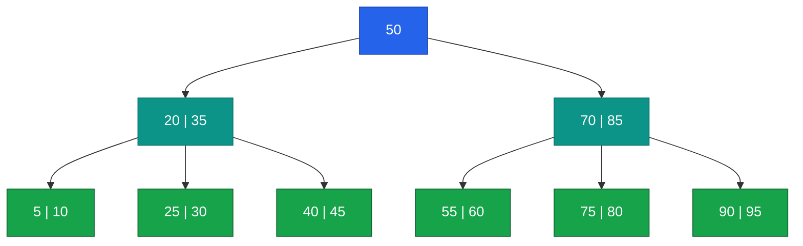

# algorithms

Notes on the many algorithm books I recently acquired.

* *Grokking Algorithms* by Aditya Y Bhargava
* *Fabulous Adventures in Data Structures and Algorithms* by Eric Lippert
* *Advanced Algorithms and Data Structures* by Marcello La Rocca
* *Algorithms and Data Structures for Massive Datasets* by Dzejla Medjedovic, Emin Tahirovic, and Ines Dedovic


## Table of Contents

* [Grokking Algorithms](#grokking-algorithms)
    * [Binary Search](#binary-search)
    * [Traveling Salesperson](#traveling-salesperson)
    * [Selection Sort](#selection-sort)
    * [Quicksort](#quicksort)
    * [Hash tables](#hash-tables)
    * [Breadth first search](#breadth-first-search)
    * [Trees](#trees)
    * [Balanced trees](#balanced-trees)
    * [Dijkstra's Algorithm](#dijkstras-algorithm)
    * [Greedy algorithms](#greedy-algorithms)
    * [Dynamic programming](#dynamic-programming)
    * [K-nearest neighbors](#k-nearest-neighbors)
    * [Some other algorithms](#some-other-algorithms)


## Grokking Algorithms

This book is designed to be easy to follow and leads with examples. After
reading a few chapters, I think it is going to serve as more of a review for
me, because it assumes absolutely no previous knowledge of algorithms
(including big-O notation, how memory works, arrays, etc.).


### Binary Search

Binary search is an algorithm that efficiently finds an element in a sorted
list. It works by choosing the midpoints and comparing to the element,
eliminating half the search space with each step, which means it runs in
**O(log n)** time.

```py
# Copied from the book.
def binary_search(arr, item):
  low = 0
  high = len(arr)-1

  while low <= high:
    mid = (low + high) // 2
    guess = arr[mid]
    if guess == item:
      return mid
    elif guess > item:
      high = mid - 1
    else:
      low = mid + 1
  return None


my_list = [1, 3, 5, 7, 9]

print(binary_search(my_list, 3))  # => 1
print(binary_search(my_list, -1)) # => None
```


### Traveling Salesperson

The traveling salesperson is a classic problem in computer science, where a
"salesperson" needs to visit "cities" and travel the fewest "miles." Solving it
(perfectly) takes **O(n!)** time because we need to check every possible
combination of city orders.


### Selection Sort

Selection sort is an **O(n²)** algorithm to sort an array. It works by
iterating through the list to *select* the lowest (or highest) element and
putting it in a new list.

```python
def findSmallest(arr):
  smallest = arr[0]
  smallest_index = 0
  for i in range(1, len(arr)):
    if arr[i] < smallest:
      smallest = arr[i]
      smallest_index = i
  return smallest_index


def selectionSort(arr):
  newArr = []
  copiedArr = list(arr) # copy array before mutating
  for i in range(len(copiedArr)):
      smallest = findSmallest(copiedArr)
      newArr.append(copiedArr.pop(smallest))
  return newArr


print(selectionSort([5, 3, 6, 2, 10]))
```


### Quicksort

Quicksort is an (average) **O(n log n)** algorithm to sort an array. It
utilizes recursion to divide a list in half and sort the smaller copies.

1. Pick a pivot
2. Partition into two sub-arrays <= and > the pivot
3. Call quicksort on the two sub-arrays
4. Merge the results

**Inductive proofs** are introduced here, which is very similar to recursion in
that there is a *base case* and an *inductive case*.

```py
def quicksort(array):
  if len(array) < 2:
    return array
  else:
    pivot = array[0]
    less = [i for i in array[1:] if i <= pivot]
    greater = [i for i in array[1:] if i > pivot]
    return quicksort(less) + [pivot] + quicksort(greater)


print(quicksort([10, 5, 2, 3]))
```

On average, quicksort is an **O(n log n)** algorithm. In the worst case, it is
**O(n²)** (such as a poorly chosen pivot on a sorted array, or an array with
all of the same elements). The author compares quicksort with mergesort, which
is also an **O(n log n)** algorithm, but it is usually slower because of the
constants (which aren't written in big-O notation).


### Hash tables

The book covers hash tables here and how they are **O(1)** on average for all
types of access. It works by hashing the input to a consistent value for
constant time lookup. It didn't go into too much detail about how they work
under the hood, but the hash is used to index a linked-list, which the item
gets added to.

The *load factor* is the
$\frac{number\ of\ items\ in\ hash}{total\ number\ of\ slots}$ and is used to
resize the backing datastructure (typically when greater than $0.7$).

The book also mentions [cityhash](https://github.com/google/cityhash) as a good
hashing algorithm, although the repository was recently archived. Searching
around revealed [xxHash](https://github.com/Cyan4973/xxHash) and
[MurmurHash](https://en.wikipedia.org/wiki/MurmurHash) among others.


### Breadth first search

This section introduces graphs, which is a collection of nodes and edges. In
the graph `A -> B`, `A` is an **in-neighbor** of `B` and `B` is an
**out-neighbor** of `A`. In an undirected graph, they are simply **neighbors**.

**Breadth first search** is an algorithm that finds if there is a path between
two nodes, and what that shortest path is. It works by searching all the
neighboring nodes before recursively expanding.

Queues are first-in-first-out (FIFO) data structures used in this algorithm to
find the shortest path. Potential candidates are added to the queue, and we
want to check them in the order they are added.

```python
def search(name):
    search_queue = deque()
    search_queue += graph[name]
    searched = set()
    while search_queue:
        person = search_queue.popleft()
        if not person in searched:
            if person_is_seller(person):
                print(person + " is a mango seller!")
                return True
            else:
                search_queue += graph[person]
                searched.add(person)
    return False

search("you")
```

The runtime complexity of this algorithm is **O(V+E)**. It's at least **O(E)**
because we might have to search the entire network (follow all of the edges)
and it's also at least **O(V)** because we enqueue / dequeue a vertex once
each.

If you represent a list of tasks as dependencies in a graph, a topologically
sorted list would be a valid ordering of the tasks. Additionally, a graph with
no cycles is called a tree.


### Trees

Trees are a type of graph with no cycles. More precisely, they are connected
acyclic graphs. There are many types of trees used for lots of different
algorithms.

**Rooted trees** are trees that have one node that leads to all other nodes.
Nodes in a rooted tree can have a parent and children. The only node with no
parent is the *root node*. Nodes with no children are called *leaf nodes*.

File directories are an example of trees (ignoring symlinks). BFS is an
algorithm that traverses every node in a graph, so we can use it for traversing
every file in a directory tree. An important distinction to the previous BFS
algorithm is that we don't need to check if we've seen a node twice because a
tree does not have cycles.

If we change our function to use recursion like so:

```python
from os import listdir
from os.path import isfile, join

def printnames(dir):
    for file in sorted(listdir(dir)):
        fullpath = join(dir, file)
        if isfile(fullpath):
            print(file)
        else:
            printnames(fullpath)

printnames("pics")
```

It prints the files in a different order because this is a **depth-first
search** algorithm. As soon as we find a directory, we recursively process that
directory, where previously we would add it to a queue for later processing.

BFS and DFS are similar algorithms that traverse every node in a graph, however
DFS cannot find the shortest path. One other use for DFS is for finding a
topological sort.

**Binary trees** are a special type of **rooted tree** where nodes can have at
most two children. Traditionally these children are called left child and right
child.

**Huffman coding** is an example of binary trees. It is a compression algorithm
that uses the frequency of letters to determine a variable length binary
representation (so more frequent letters have fewer bits). A binary tree is the
map between letters and bits. Each letter sits at a leaf node. Traversing left
is a `0` and right is a `1`.


### Balanced trees

This section starts out by explaining that sorted arrays are *great* at finding
values, but insertion is slow, and linked lists are the opposite. The goal is
to get the best of both worlds. We want a search that is *O(log n)* and an
insert that is faster than *O(n)*, which a balanced binary search tree (BST)
gives us.

A BST is a binary tree where the left child is always less than the node and
the right child is always greater than the node. The performance of this tree
depends on it being balanced. More accurately, we want the tree to be balanced
so that there are fewer steps to reach all nodes. A very unbalanced binary tree
takes linear time to search.

**AVL trees** are a type of self-balancing BST. It achieves this through
*rotations*. A rotation reorganizes a sub-tree so that it is balanced while
maintaining the BST properties of order. A simple example of A->B->C would get
rotated to A<-B->C, where **B** is now the root node instead of **A**.

The AVL tree needs to keep track of some additional metadata to know when to
rotate. Each node has either a *balance factor* or *height* that it tracks. The
balance factor is the value of right nodes minus left nodes in a tree, which
can be recursively calculated. When the balance factor exceeds ±1, it's time to
rebalance. Then the new balance factor propogates up the tree.

A **splay tree** is a tree that changes its root node to be the last node you
looked up, so recently accessed data is faster to access. Splay trees are not
always balanced, but the average search time is *O(log n)*.

**B-trees** are a generalized form of a binary tree, often used for building
databases by taking advantage of colocated data. B-trees are shaped like so:
the root node has one key and two children. The next layer has two keys and
three children each. The next, three keys and four children each, and so on.




### Dijkstra's Algorithm

Breadth first search finds the shortest number of edges between two nodes in a
graph. Dijkstra's algorithm finds the shortest weighted path between two nodes,
where each edge can have any non-negative weight. The graph must also not
contain any cycles.

There are four steps:

1. Find the "cheapest" node. This is the node you can get to with the least
   value.
2. Update the costs of the out-neighbors of this node.
3. Repeat this for all nodes in the graph.
4. Calculate the final path.


```python
def find_lowest_cost_node(costs):
    lowest_cost = math.inf
    lowest_cost_node = None
    for node in costs:
        cost = costs[node]
        if cost < lowest_cost and node not in processed:
            lowest_cost = cost
            lowest_cost_node = node
    return lowest_cost_node

node = find_lowest_cost_node(costs)
while node is not None:
    cost = costs[node]
    neighbors = graph[node]
    for n in neighbors.keys():
        new_cost = cost + neighbors[n]
        if costs[n] > new_cost:
            costs[n] = new_cost
            parents[n] = node
    processed.add(node)
    node = find_lowest_cost_node(costs)
```

This code example can be improved with the use of priority queues, instead of
iterating over each node to find the lowest cost one.


### Greedy algorithms

Greedy algorithms are simple algorithms that always take the locally optimal
solution at each step. This sometimes ends up being the optimal solution (like
for the class-scheduling problem), and sometimes it isn't (like for the
knapsack problem).

Greedy algorithms can be used as **approximation algorithms** that get a *good
enough* solution to a problem much faster (like the set covering problem).

Most NP-hard problems will use approximation algorithms to solve them
practically.


### Dynamic programming

Dynamic programming solves small subproblems that builds up to solving the
entire problem. A classic example of this is solving the knapsack problem.

The book walks through how to do this using a grid where one axis is the
knapsack size and the other is the item. For each cell, you calculate the
maximum value by either taking the previous item's maximum value for that
weight, or the current item's value plus the value of the remaining space.

Dynamic programming only works when each subproblem is discrete and does not
depend on other subproblems. It's only useful when you want to optimize
something given a constraint.

**Example:**

* Water: 3 lb, 10 value
* Book: 1 lb, 3 value
* Food: 2 lb, 9 value
* Jacket: 2 lb, 5 value
* Camera: 1 lb, 6 value

|            | **1 lb** | **2 lb** | **3 lb** | **4 lb** | **5 lb** | **6 lb** |
|------------|----------|----------|----------|----------|----------|----------|
| **water**  | 0        | 0        | 10 (w)   | 10 (w)   | 10 (w)   | 10 (w)   |
| **book**   | 3 (b)    | 3 (b)    | 10 (w)   | 13 (wb)  | 13 (wb)  | 13 (wb)  |
| **food**   | 3 (b)    | 9 (f)    | 12 (bf)  | 13 (wb)  | 19 (wf)  | 22 (wbf) |
| **jacket** | 3 (b)    | 9 (f)    | 12 (bf)  | 14 (fj)  | 19 (wf)  | 22 (wbf) |
| **camera** | 6 (c)    | 9 (f)    | 15 (fc)  | 18 (bfc) | 20 (fjc) | **25 (wfc)** |

Dynamic programming typically follows this shape, but it's not always the same
algorithm. The book goes on to use *longest common substring* and *largest
common subsequence* as examples.

For the longest common substring problem, one axis is the letters of one word
and the other axis is the letters of the other word. For each cell, take the
value of the cell to the upper left and add one if the letter match. In this
example, the optimal solution is not the lower right cell.

**Example:** Longest common subsequence of "blue" and "clues"

|       | **B** | **L** | **U** | **E** |
|-------|-------|-------|-------|-------|
| **C** |   0   |   0   |   0   |   0   |
| **L** |   0   |   1   |   0   |   0   |
| **U** |   0   |   0   |   2   |   0   |
| **E** |   0   |   0   |   0   | **3** |
| **S** |   0   |   0   |   0   |   0   |


### K-nearest neighbors

K-nearest neighbors (KNN) is an algorithm to *classify* an item. It looks at
the $k$ nearest neighbors to see which category it likely belongs to. In order
to do that, it requires *feature extraction*, which maps a set of features into
a vector (or a group of numbers). This allows you to compare two items by using
the distance formula or cosine similarity (which compares the angle of two
vectors instead of distance).

KNN is also useful for *regressions*, or predicting a value given a new item.
For example, if you want to predict how Alice will rate a movie, find her
k-nearest neighbors and take the average of their ratings for the movie.

This naturally leads into *machine learning*, which involves gathering data,
cleaning it, extract features, then training a model. It's typical to use 90%
of your data to train and 10% to validate.


### Some other algorithms

The book wraps up by listing off some other data structures and algorithms that
weren't covered:

* **Linear regression** - fit a line to a collection of points
* **Inverted indexes** - a hash table of words to indices (or places they appear);
  useful for search engines
* **Fourier transform** - convert between time and frequency domains
* **Parallel algorithms** - a general category of algorithms that take
  advantage of parallelism (like a version of quicksort that can run in $O(n)$
  time)
* **Map/reduce** - a distributed algorithm to handle extremely large amounts of
  data
* **Bloom filters and HyperLogLog** - probabilistic data structures!
* **HTTPS and the Diffie–Hellman key exchange** - cryptography! (and a [book recommendation](https://www.manning.com/books/real-world-cryptography))
* **Locality-sensitive hashing** - simhash will generate similar hashes for inputs that are similar, which is sometimes useful
* **Min heaps and priority queues** - data structure built using trees where the root is always the minimum value (which is useful for building priority queues)
* **Linear programming** - used to maximize something given some linear constraints; this is a very powerful framework for optimizations
